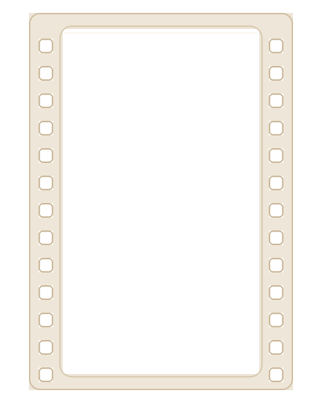
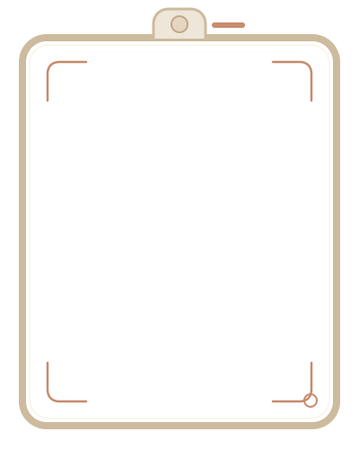

# The Wedding Roll — Phase 2.5 Decor Artwork Preview

Template key: `the-wedding-roll-recap`
Status: the two light-color SVG frame alternatives were approved on 2026-11-04 and integrated into the React renderer in Phase 5. The independent concept HTML remains unchanged. The Phase 5 sprocket ornament closes the remaining ambient decor role.

## Asset brief

Create two renderer-owned overlays that frame owner-supplied wedding photos while leaving the photo aperture genuinely transparent. Keep the 35mm editorial direction in pale ivory, champagne and soft rust, compatible with the continuous ivory canvas. Do not generate sample photos, people, text, numerals, logos or watermarks.

## Preview sheet

### 1. Film negative frame

Role: `photo-frame` / film perforation border. Intended for selected hero, chapter or moment images where a distinct contact-print treatment is useful. It is a photo frame, not a section background.

### 2. Camera viewfinder frame

Role: `camera-viewfinder-frame`. Intended for a limited number of hero or behind-the-scenes photos as an alternate frame treatment; do not stack it with the film-negative frame on the same image.

## Asset matrix

| Asset | Size / format | Transparent area | Safe placement | Breakpoint notes |
|---|---|---|---|---|
| `film-frame.svg` | 400 × 500 SVG | Transparent outside and through the central photo aperture | Scale as an overlay around a replaceable portrait image; keep full perforated sides visible | Keep full frame within mobile gutter; reduce ornament detail before cropping edges |
| `camera-viewfinder-frame.svg` | 400 × 500 SVG | Transparent outside and inside the viewfinder aperture | Use as an alternate photo frame, not as an independent content image | Scale with its photo container; keep top shutter detail and corner marks inside the safe area |

Both assets are 2D renderer-owned artwork. Their apertures are transparent so a user photo can remain the content layer. Decorative alt text should be empty when applied as CSS/background decoration; if exposed as meaningful inline artwork, provide a concise label without repeating the photo's alt text.

## Prompt and provenance record

- Original dark drafts: built-in OpenAI image generation tool through the repo image workflow. Lighter raster edits were rejected after alpha inspection found stray pixels in the openings. The displayed v2 SVG alternatives are project-authored redraws with empty apertures.
- Date: 2026-11-04.
- License/source: original generated artwork for GMM Wedding; no external reference image, template image, logo, typography or photo was used.
- Film-frame prompt: “Create one original transparent PNG decorative overlay for a premium mobile-first Wedding Recap called The Wedding Roll. Asset role: a single 35mm photographic film frame to sit directly over a real user-uploaded wedding photo. Portrait 4:5 overall silhouette, centered composition. Use a deep espresso-brown translucent film border with small evenly spaced sprocket perforations along both long sides, very restrained warm rust-orange edge glints, subtle fine analog grain, softly worn but refined editorial craftsmanship. The central 80% photo aperture must be completely transparent alpha, genuinely empty so the real photo underneath shows through; no image, scene, subject, tint, gradient, glass, fog, checkerboard, or color fill inside the aperture. Transparent outside the frame as well. Keep all corners and complete border inside canvas with generous transparent safe padding; nothing cropped. No text, numbers, labels, logos, watermark, people, camera, flowers, or extra objects. The frame should remain legible and lightweight on a phone, not thick or ornate. No mockup presentation, no background.”
- Camera-frame prompt: “Create one original transparent PNG photo-frame overlay for the same premium editorial Wedding Recap, The Wedding Roll, visually distinct from a 35mm film strip. Asset role: a refined vintage camera viewfinder frame that sits around a real user-uploaded wedding photo. Portrait 4:5 composition, complete object fully inside canvas with generous clear padding. Build only the border from a few clean, tactile camera-viewfinder cues: slim espresso-ink rounded rectangular frame, four precise focus-corner brackets, a small understated brass/rust shutter/flash detail integrated into the top border, and one subtle circular focus ring on an outer corner. Warm ivory highlights and restrained rust-orange accents, lightly aged metal/printed-paper material, refined editorial 35mm journal aesthetic. The central 82% photo aperture must be completely transparent alpha, genuinely empty so a real photo can show through; no image, scene, subject, tint, gradient, glass, fog, checkerboard, or color fill in the aperture. Transparent outside the frame too. All geometry stays inside the canvas; no crop-dependent marks. Thin, elegant and readable at phone size. No camera body or lens filling the center, no people, photos, text, numbers, icons, logos, watermark, flowers, extra props, or background. No mockup presentation.”
- Camera aperture cleanup prompt: “Edit this existing transparent image only to clean its photo aperture. Preserve the camera-viewfinder frame, material, colors, dimensions, silhouette, detail, and transparent outer background exactly as they are. Make the entire central photo aperture completely transparent alpha=0, including every pixel inside the inner opening; remove any tiny specks or stray marks inside that opening. Keep every opaque frame pixel and its edge antialiasing intact. The finished frame must still be a transparent PNG overlay with a genuinely empty center for a real user photo. Do not add anything, do not alter the border, do not crop or resize.”
- The SVG artwork has no filled center path, so the photo openings remain transparent at every scale.

## Integration map and approval checklist

- `film-frame.svg`: candidate photo-frame role for hero, chapters and selected moments; use sparingly so guests can still scan photos quickly on mobile.
- `camera-viewfinder-frame.svg`: alternate camera/viewfinder frame for one hero or behind-the-scenes photo; do not layer with the film frame on the same item.
- Keep media upload fields and renderer artwork separate. Neither frame replaces the photo source or supplies a sample photo.
- [x] Two light-color SVG frame alternatives saved in the template asset directory with transparent apertures.
- [x] SVG center openings confirmed transparent by construction.
- [x] User approves these two light frame variants for integration.
- [x] Film frame and viewfinder frame are placed on separate replaceable photos; no frame stacking.
- [x] Supporting page-edge sprocket ornament is recorded in the Phase 5 manifest/source map.
- [x] Verify frame placement at mobile/tablet/desktop in the Phase 5 screenshot report.

