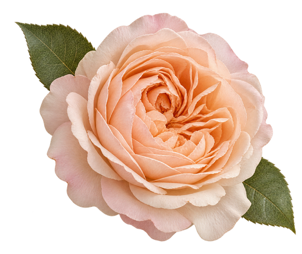
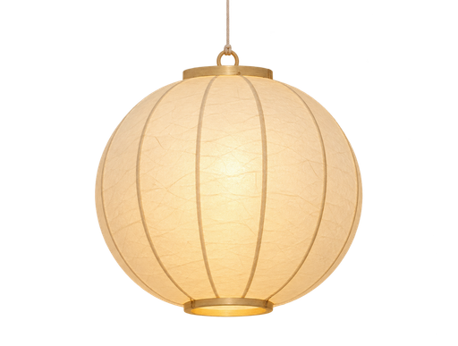
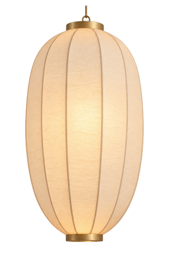
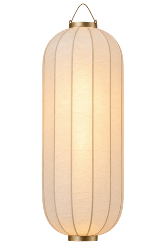
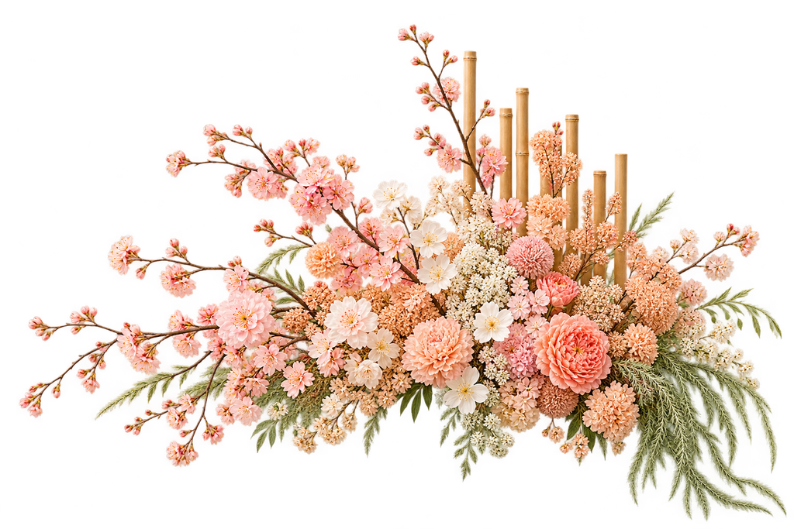
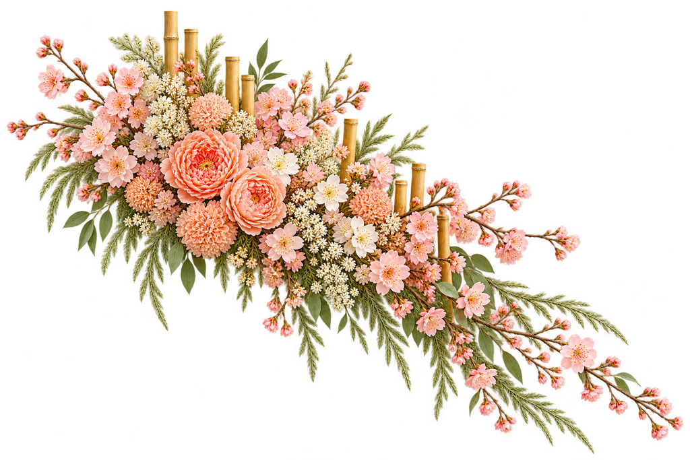
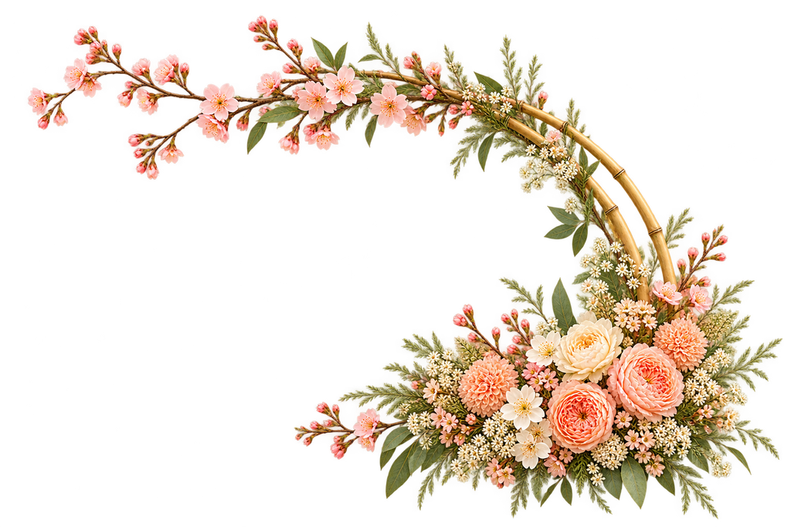
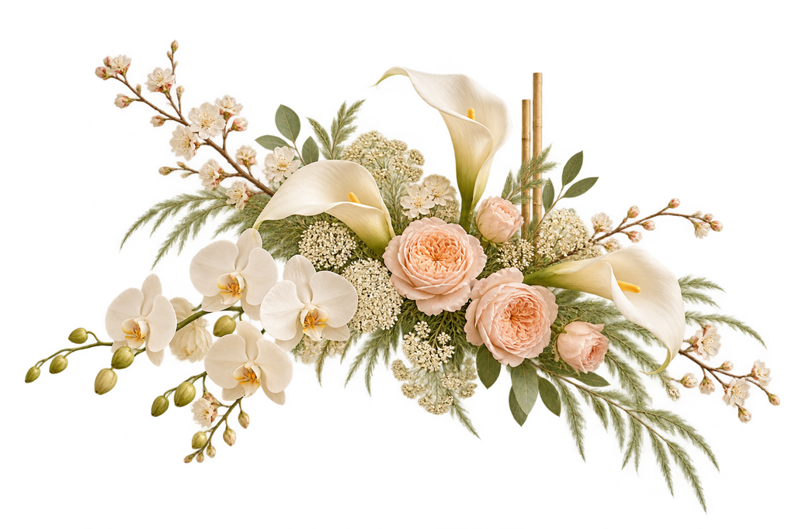
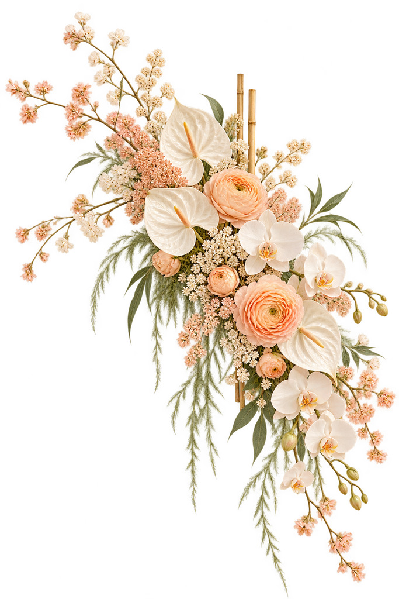
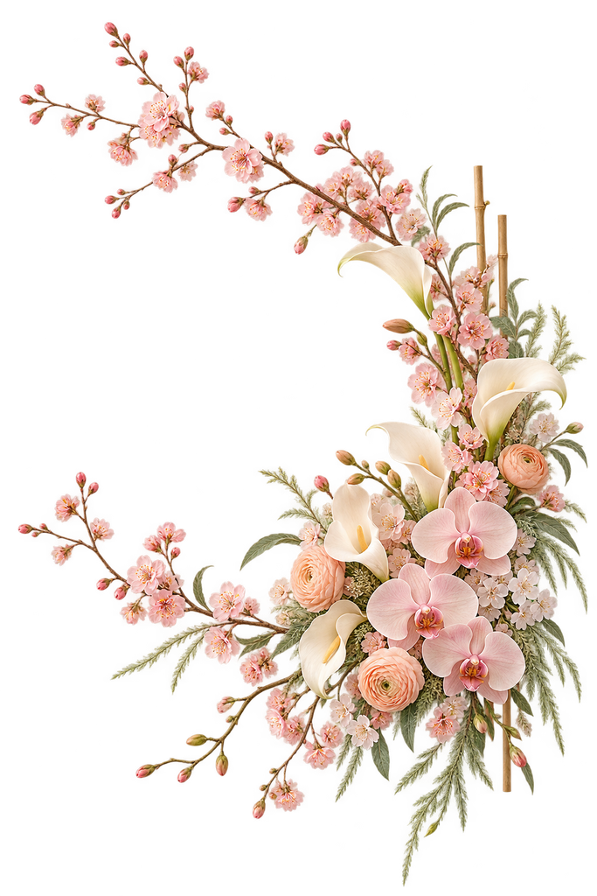

# A Beautiful Day — Approved Artwork Preview

These are renderer-owned artwork assets generated from the approved Phase 1/2 direction and user-approved art direction. The active set is approved and served as optimized lossless WebP; PNG originals remain outside the frontend bundle. Alpha edges were reviewed on ivory and dark backgrounds, and the MinIO images informed mood/material only; they were not edited or copied into these outputs.

## Curtain frame — four approved options

`abd-curtain-frame-v01.webp` — User-approved classic mood option; keep as a selectable alternate.

### Variant A — asymmetrical gathered canopy

`abd-curtain-frame-v02.webp` — Soft organza canopy and side falls.

### Variant B — pleated panels and tiebacks

`abd-curtain-frame-v03.webp` — Separate pleated panels with relaxed tiebacks.

### Variant C — asymmetrical curved canopy

`abd-curtain-frame-v04.webp` — Asymmetrical longer and shorter falls under a curved canopy.

## Single flower

`abd-single-blossom-v02.webp` — One isolated bloom, replacing the previous multi-flower divider direction.

## Three separate lantern types

### Round lantern

`abd-lantern-round-v02.webp`

### Oval lantern

`abd-lantern-oval-v02.webp`

### Tall cylindrical lantern

`abd-lantern-column-v02.webp`

Each lantern is a separate approved file so it can be placed independently. The rejected floral-cluster v02 and paired lantern were removed. The multi-flower divider and bamboo-backed cluster v01 remain archived. All production artwork is in the public bundle; alpha-edge review and optimization are complete.

## Floral and bamboo cluster variations

These three approved arrangements follow archived `abd-floral-bamboo-cluster-v01` as a style reference, with different silhouettes for independent placement. Their optimized transparent edges were reviewed on light and dark backgrounds.

### Low horizontal spray

`abd-floral-bamboo-cluster-v02.webp`

### Diagonal cascade

`abd-floral-bamboo-cluster-v03.webp`

### Crescent arrangement

`abd-floral-bamboo-cluster-v04.webp`

## Revised modern floristry

The v05–v07 set uses less prominent bamboo and contemporary sculptural flowers. These are also user-approved; alpha-edge QA remains open.

### Low horizontal spray

`abd-floral-bamboo-cluster-v05.webp`

### Diagonal cascade

`abd-floral-bamboo-cluster-v06.webp`

### Airy crescent

`abd-floral-bamboo-cluster-v07.webp`
