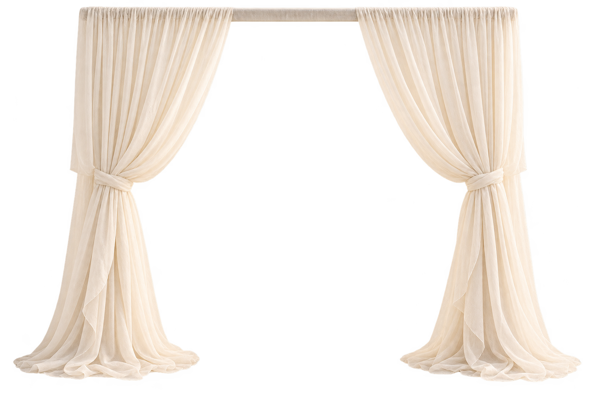
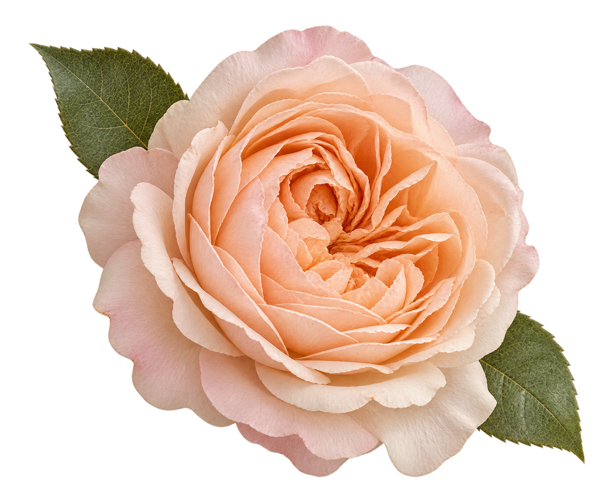
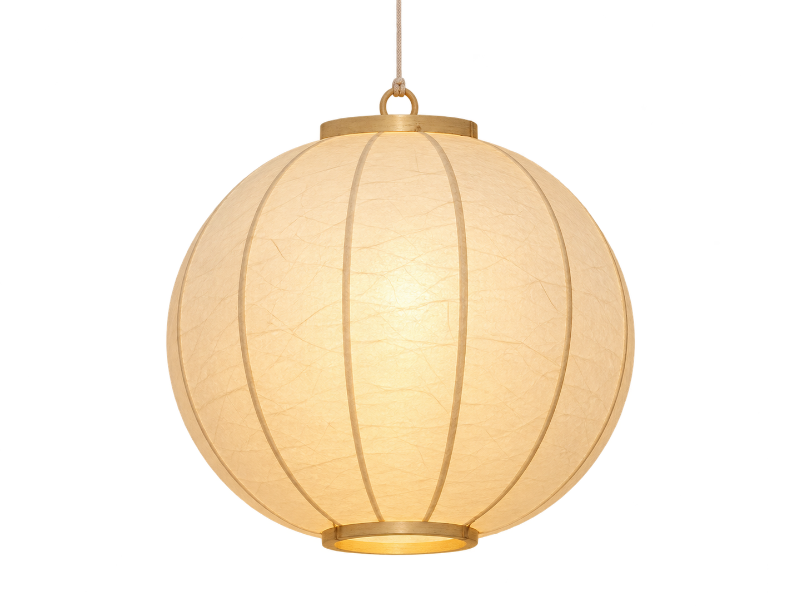
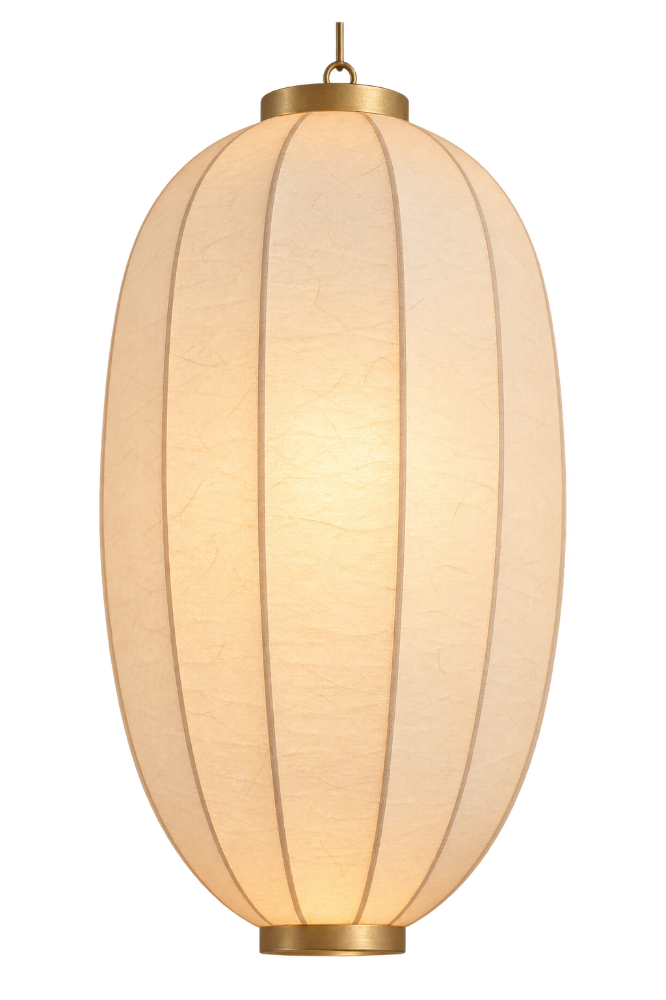
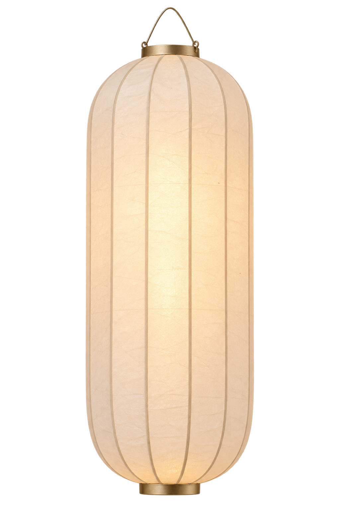
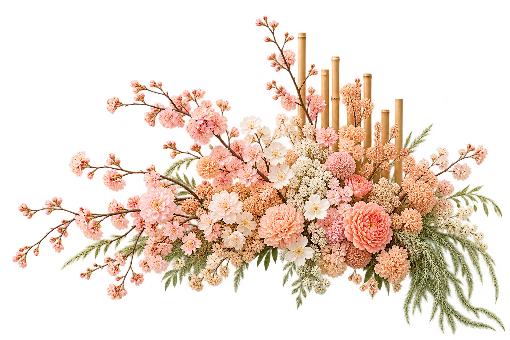
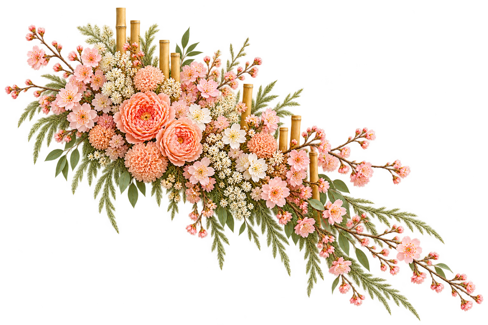
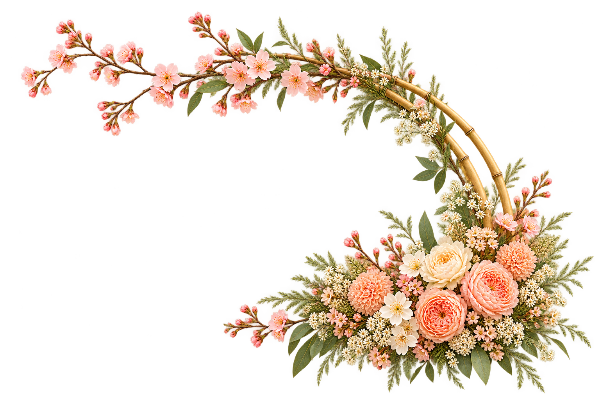

# A Beautiful Day — Artwork Candidate Preview

These are renderer-owned artwork candidates generated from the approved Phase 1/2 direction and your latest feedback. They are not imported by the renderer and are awaiting review. The MinIO images informed mood/material only; they were not edited or copied into these outputs.

## Curtain frame — mood reference and three variants

`abd-curtain-frame-v01.png` — Mood/color baseline. Generate three new options for more photographic fabric realism.

### Variant A — asymmetrical gathered canopy

`abd-curtain-frame-v02.png` — Soft organza canopy and side falls.

### Variant B — pleated panels and tiebacks

`abd-curtain-frame-v03.png` — Separate pleated panels with relaxed tiebacks.

### Variant C — asymmetrical curved canopy

`abd-curtain-frame-v04.png` — Asymmetrical longer and shorter falls under a curved canopy.

## Single flower

`abd-single-blossom-v02.png` — One isolated bloom, replacing the previous multi-flower divider direction.

## Three separate lantern types

### Round lantern

`abd-lantern-round-v02.png`

### Oval lantern

`abd-lantern-oval-v02.png`

### Tall cylindrical lantern

`abd-lantern-column-v02.png`

Each lantern is a separate candidate file so it can be placed independently. The rejected floral-cluster v02 and paired lantern were removed. The old blossom divider remains an archived draft; the bamboo-backed v01 is used as a style reference for the new cluster variations. All new files remain full-size PNG candidates; edge review, optimization, and final approval are still pending.

## Floral and bamboo cluster variations

These three new arrangements follow `abd-floral-bamboo-cluster-v01` as a style reference, with different silhouettes for independent placement. They remain candidates pending visual and edge review.

### Low horizontal spray

`abd-floral-bamboo-cluster-v02.png`

### Diagonal cascade

`abd-floral-bamboo-cluster-v03.png`

### Crescent arrangement

`abd-floral-bamboo-cluster-v04.png`
